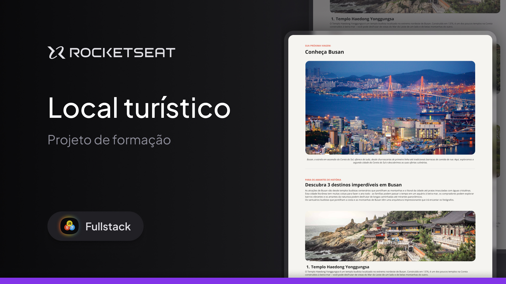

<h1 align="center"> Local Turístico ✈️</h1>

Página sobre Busan, na Coreia do Sul, com três destinos imperdíveis da cidade

  <a href="#-tecnologias">Tecnologias</a>&nbsp;&nbsp;&nbsp;|&nbsp;&nbsp;&nbsp;
  <a href="#-projeto">Projeto</a>

  
 

## 🚀 Tecnologias

Esse projeto foi desenvolvido com as seguintes tecnologias:

- HTML e CSS
- Figma
- Git e Github

## 💻 Projeto

- O Local Turístico é uma página web desktop que apresenta Busan, na Coreia do Sul, e três destinos imperdíveis da cidade: o Templo Haedong Yonggungsa, o Templo Beomeo-sa e o Parque Yongdusan, cada um com foto e descrição.

- Foi desenvolvido como desafio prático da formação Full-Stack da Rocketseat, reproduzindo um layout do Figma com HTML semântico e CSS.

<h2 align="center">📌 Desenvolvedores</h2>

<table align="center">
  <tr>
    <td align="center">
      <a href="https://github.com/rebellatoGui" title="GitHub">
         
        
          <b>Guilherme Rebellato</b>
        
      </a>
    </td>
  </tr>
</table>

 

---

Feito com ♥ por rebellatoGui

